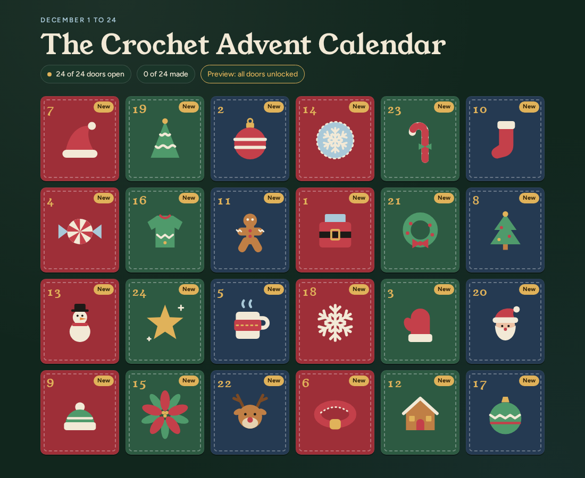
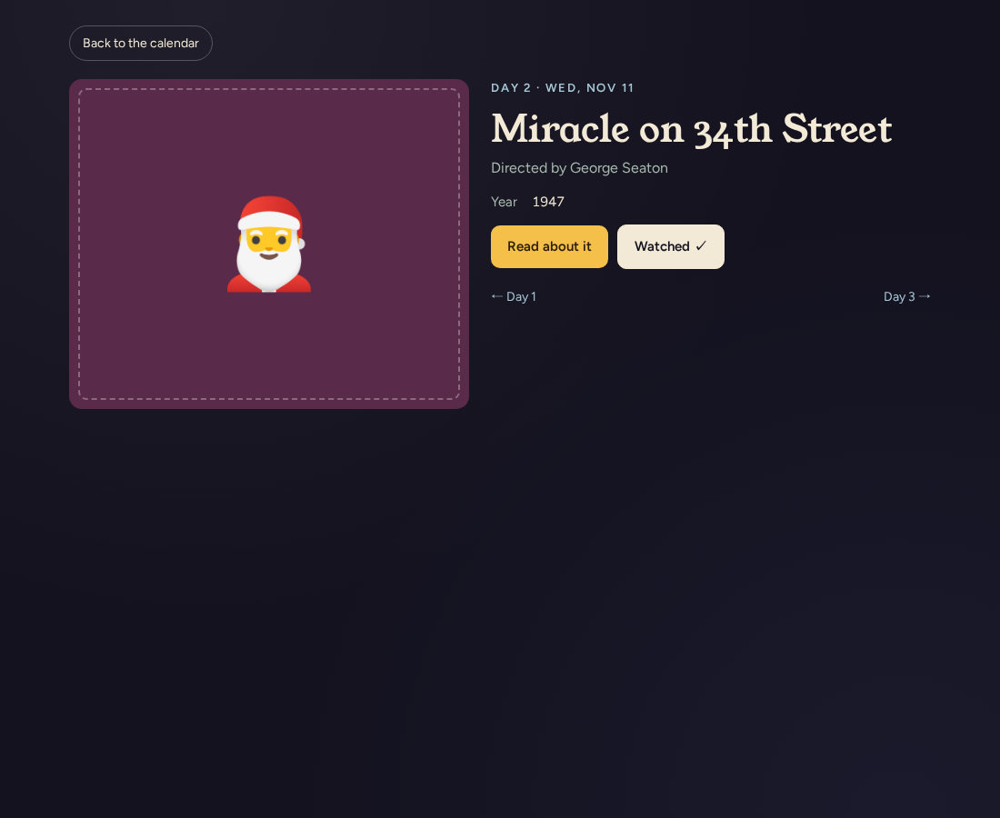
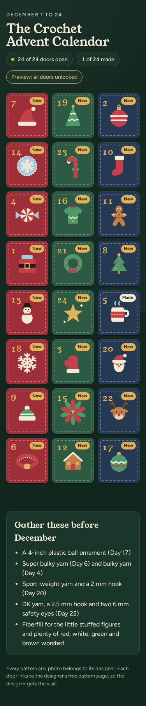
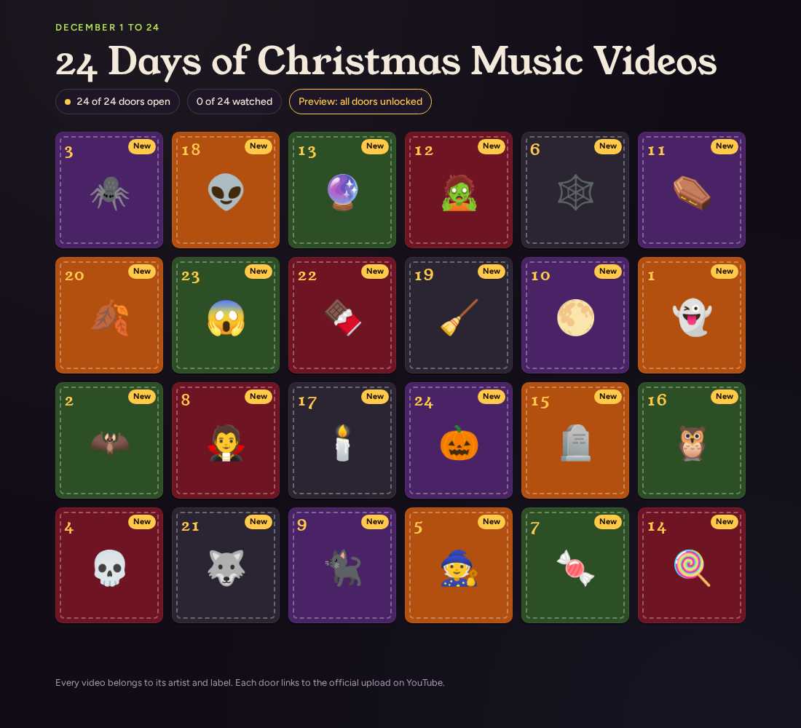

# Advent Calendar

A small, self-hosted advent calendar for **any list of links**. Each day unlocks a door. Behind each door is a card with a picture, a short description and a link: a craft pattern, a recipe, a music video, a book, a puzzle, whatever you like.

The whole calendar is defined in **one JSON file**. You don't need to write code, set up a database or create accounts.



## Features

- **Any dates, any length.** 24 days of December, 12 nights of Christmas, a 31-day October countdown, or a single surprise door. Ranges can cross months.
- **Doors unlock by date** at local midnight in the visitor's time zone. Locked doors show when they open.
- **One JSON file** sets the title, wording, colors, door order and every entry. Edits show up on the next page refresh, with no restart needed.
- **Pictures for every door:** 24 built-in festive drawings, any emoji, or your own image URLs. A photo can also be shown on each entry's card.
- **Track what's done** ("Mark as made", "Mark as watched", and so on). Progress is kept per browser, or optionally shared on the server.
- **Theming:** background, text, accent and door colors are all configurable.
- **Works on phones.** The grid narrows from 6 columns to 4 to 3. Keyboard navigation works, and reduced-motion settings are respected.
- **Tiny footprint:** one Python file using only the standard library, plus one HTML file. The image is about 50 MB, there are no runtime dependencies, and it runs as a non-root user.
- **Preview mode:** open `/#preview` to unlock every door while you build the calendar.

| Detail card | On a phone | Re-themed |
|---|---|---|
|  |  |  |

## Quick start

You need Docker with the Compose plugin.

```sh
git clone https://github.com/<you>/advent-calendar.git
cd advent-calendar
docker compose up -d --build
```

Open **http://localhost:8080**. You'll see the bundled sample calendar, which is 24 free crochet patterns.

### Make it your own

1. Start from the small example:
   ```sh
   cp config/example.json config/my-calendar.json
   ```
2. Edit `config/my-calendar.json`. At minimum, change `id`, `title`, `startDate`, `days` and `entries`.
3. Point the app at your file and start it:
   ```sh
   echo "CALENDAR_FILE=my-calendar.json" > .env
   docker compose up -d
   ```
4. Open `http://localhost:8080/#preview` to check every door before the first one opens. Open `#preview` again to turn preview off.

After that, edit the JSON and refresh the browser. If the file has a mistake, the page lists exactly what's wrong instead of showing a blank screen.

## Configuration

### A minimal calendar

```json
{
  "id": "cookie-countdown",
  "title": "3 Days of Cookies",
  "startDate": "2026-12-13",
  "days": 3,
  "entries": [
    { "title": "Gingerbread Men", "url": "https://example.com/gingerbread", "icon": "gingerbread" },
    { "title": "Sugar Cookies",   "url": "https://example.com/sugar",       "icon": "🍪" },
    { "title": "Snickerdoodles",  "url": "https://example.com/snickerdoodle" }
  ]
}
```

`days` must equal the number of entries. Entry 1 opens on `startDate`, entry 2 the next day, and so on.

### Top-level fields

Only `title`, `startDate`, `days` and `entries` are required.

| Field | Default | Description |
|---|---|---|
| `id` | `"calendar"` | Short unique name (letters, digits, `-`, `_`). Keeps saved progress separate between calendars, so **give every calendar its own id**. |
| `title` | — | Page heading and browser tab title. |
| `subtitle` | auto, e.g. "December 1 to 24" | Small line above the title. |
| `startDate` | — | `"YYYY-MM-DD"`. The day door 1 unlocks. |
| `days` | — | Number of doors, 1–366. |
| `order` | `"sequential"` | Door layout in the grid: `"sequential"`, `"shuffled"` (a stable shuffle based on `id`, so it's the same on every visit), or an explicit list such as `[7, 19, 2, …]` with every day exactly once. |
| `progress` | `"browser"` | Where "done" marks are stored. See [Progress modes](#progress-modes). |
| `allowPreview` | `true` | Whether `#preview` can unlock all doors. Set it to `false` if you'd rather visitors couldn't peek. |
| `locale` | visitor's browser | Language for dates, e.g. `"en-US"`, `"en-GB"`, `"de-DE"`. |
| `labels` | see below | All wording on the page. |
| `theme` | dark pine and brass | Colors. See [Theming](#theming). |
| `panel` | none | An info box under the grid: `{ "heading": "Gather these first", "items": ["…", "…"] }`. Handy for supply or shopping lists. |
| `footer` | none | Small print at the bottom of the page. |
| `entries` | — | One object per day, in day order. |

### Entry fields

| Field | Required | Description |
|---|---|---|
| `title` | yes | The entry's name. |
| `url` | yes | Where the main button links. Must start with `http://` or `https://`. Opens in a new tab. |
| `by` | | Credit line, shown as "*byPrefix* *by*", e.g. "Pattern by Jane Doe". |
| `blurb` | | A sentence or two of description. |
| `img` | | A photo shown on the detail card. If it fails to load, the door picture is shown instead. |
| `icon` | | The door picture: a [built-in icon](#built-in-icons) name, an emoji, or an image URL. If left out, the door shows the entry's title. |
| `facts` | | Key/value pairs shown as a small table, e.g. `{ "Time": "1 hr", "Difficulty": "Easy" }`. |
| `notes` | | A list of short bullet points. |
| `linkText` | | Overrides `labels.openLink` for this entry only. |

### Labels

Every piece of text on the page can be changed, so you can match the wording to what's behind the doors. Override only the ones you need:

```json
"labels": {
  "markDone": "Mark as watched",
  "done": "Watched ✓",
  "doneTag": "Watched",
  "doneCount": "watched",
  "openLink": "Watch on YouTube"
}
```

| Key | Default | Where it appears |
|---|---|---|
| `day` | `Day` | "Day 5", navigation |
| `doors` | `doors open` | "6 of 24 doors open" |
| `doneCount` | `done` | "3 of 24 done" |
| `untilFirst` | `until the first door` | Countdown before the start date |
| `dayOne` / `dayMany` | `day` / `days` | Countdown units |
| `newTag` | `New` | Badge on doors not yet viewed |
| `doneTag` | `Done` | Badge on completed doors |
| `markDone` / `done` | `Mark as done` / `Done ✓` | Toggle button, off and on |
| `openLink` | `Open the link` | Main button |
| `byPrefix` | `By` | Credit line |
| `back` | `Back to the calendar` | Detail view |
| `opensOn` | `opens on` | Locked-door message |
| `preview` | `Preview: all doors unlocked` | Preview badge |
| `syncOff` | `Progress sync unavailable; saving in this browser` | Shown if server progress can't be reached |

### Theming

```json
"theme": {
  "bg": "#110c15",
  "surface": "#1e1626",
  "text": "#f3eadc",
  "accent": "#ffc94a",
  "accentText": "#1a0d00",
  "highlight": "#d9480f",
  "info": "#b5e655",
  "muted": "#a99bb3",
  "tiles": ["#4a2366", "#b4500f", "#2c4f25", "#6e1423", "#2b2433"]
}
```

| Key | Used for |
|---|---|
| `bg` | Page background |
| `surface` | Info panel and status pills |
| `text` | Main text, the "Done" badge, and the light parts of built-in icons |
| `accent` | Day numbers, "New" badges, main button, today's glow |
| `accentText` | Text on top of `accent` (keep it readable) |
| `highlight` | The red parts of built-in icons |
| `info` | Small headings such as the subtitle and day/date line |
| `muted` | Secondary text |
| `tiles` | Door colors, cycled in grid order. Use as many as you like. |

Any CSS color works: hex, `rgb()`, or names like `"darkgreen"`. Invalid values are ignored. Day numbers are drawn in `accent` on top of the tile colors, so pick an accent that reads on all of them.

### Built-in icons

Hand-drawn SVGs that follow your theme colors:

`gift-card` `bauble` `mitten` `peppermint` `mug` `ear-warmer` `santa-hat` `tree` `beanie` `stocking` `gingerbread` `gingerbread-house` `snowman` `coaster` `poinsettia` `sweater` `bulb` `snowflake` `cone-tree` `santa` `wreath` `reindeer` `candy-cane` `star`

Anything else up to 8 characters is shown as text, which is meant for emoji (`"🎃"`). Values starting with `http(s)://` are loaded as images.

## Progress modes

| `"progress"` | Behavior | Good for |
|---|---|---|
| `"browser"` (default) | "Done" marks are saved in each visitor's browser (`localStorage`). Nothing is stored on the server. | Calendars shared with several people who each track their own progress. |
| `"server"` | Marks are saved on the server in `data/progress-<id>.json` and **shared by everyone** who opens the calendar. | One household or one person using several devices. |

"New" badges always stay per-browser. In server mode, if the API can't be reached, the page falls back to the browser and shows a notice.

## Running more than one calendar

Each container serves one calendar. To run several:

- **Same folder, more services.** Add a second service to `docker-compose.yml` with its own `container_name`, host port and `CALENDAR_FILE`. Both services can share `./config` and `./data`, as long as each calendar has its own `id`.
- **Separate folders.** Clone the repo again and change `container_name`, `image` and the host port in the copy's `docker-compose.yml`.

```yaml
services:
  crochet:
    build: .
    image: advent-calendar:local
    container_name: advent-crochet
    ports: ["8080:8080"]
    environment: { CALENDAR_FILE: calendar.json }
    volumes: ["./config:/config:ro", "./data:/data"]
    restart: unless-stopped
  movies:
    image: advent-calendar:local
    container_name: advent-movies
    ports: ["8091:8080"]
    environment: { CALENDAR_FILE: movies.json }
    volumes: ["./config:/config:ro", "./data:/data"]
    restart: unless-stopped
```

## Deployment notes

### Environment variables

| Variable | Default | Description |
|---|---|---|
| `CALENDAR_FILE` | `calendar.json` | Which file in the config directory to serve |
| `CONFIG_DIR` | `/config` | Where calendar files are read from |
| `DATA_DIR` | `/data` | Where server-mode progress is written |
| `PORT` | `8080` | Port inside the container |

### Volumes

- `./config` → `/config` is **mounted read-only**. Your calendar files live here.
- `./data` → `/data` holds the progress files, and only in server mode. Back it up if those marks matter to you. The container runs as UID 1000, so the host folder must be writable by that user.

### Behind a reverse proxy

The app serves plain HTTP and doesn't need WebSockets or special headers. The page uses relative URLs, so it also works under a sub-path, as long as the proxy strips the prefix and the path ends with `/`.

**Caddy**
```
calendar.example.com {
    reverse_proxy localhost:8080
}
```

**nginx (sub-path)**
```nginx
location = /advent { return 301 /advent/; }
location /advent/ {
    proxy_pass http://127.0.0.1:8080/;
}
```

### Health check

`GET /healthz` returns `{"ok": true}`, or the list of config errors with HTTP 500. The Docker image has a `HEALTHCHECK` built in, so `docker ps` shows `healthy`. Uptime monitors such as Uptime Kuma can poll the same URL.

### Security and privacy

- **There's no login.** Anyone who can reach the port can see the calendar. In server progress mode, they can also change the shared marks. That's fine on a home network. If you put it on the internet, put it behind your reverse proxy's authentication, or keep `"progress": "browser"`.
- **The progress API only accepts** `{"day": <1..days>, "done": <bool>}` with a body of 1 KB or less. Writes are atomic.
- **Text from the config is HTML-escaped,** and only `http(s)` URLs are accepted for links and images.
- **Third-party requests:** the page loads fonts from Google Fonts, plus any image URLs you put in the config. Images load with `no-referrer`. There are no analytics or trackers.

### Updating

```sh
git pull
docker compose up -d --build
```

Your files in `config/` and `data/` aren't touched. If you've changed the bundled `config/calendar.json`, `git pull` may report a conflict. Keep your own calendars in separate files to avoid that.

## HTTP API

| Method and path | Description |
|---|---|
| `GET /` | The calendar page |
| `GET /calendar.json` | The active config, or `{"errors": [...]}` if it's invalid |
| `GET /healthz` | Health and config validation |
| `GET /api/progress` | `{"finished": [1, 5, ...]}`, server mode only (404 otherwise) |
| `PUT /api/progress` | Body `{"day": 5, "done": true}`. Returns the updated list. Server mode only. |

## Development

Without Docker:

```sh
CONFIG_DIR=./config DATA_DIR=./data PORT=8080 python3 app/server.py
```

Python 3.9+ with only the standard library. The front end is a single file, `app/public/index.html`, with inline CSS and JS and no build step.

```
app/server.py           HTTP server, config validation, progress API
app/public/index.html   The entire front end
config/calendar.json    Sample: The Crochet Advent Calendar (24 free patterns)
config/example.json     Sample: 12 Nights of Movies (a smaller template to copy)
data/                   Server-mode progress (git-ignored)
Dockerfile              python:3.13 Alpine, non-root, with health check
docker-compose.yml      One service on port 8080
```

To add a built-in icon, add an entry to the `ICONS` object in `index.html`. Icons are drawn on a 64×64 `viewBox` with the paint classes defined in the stylesheet (`f-r`, `s-w`, …), so they follow the theme.

## Credits

The sample crochet calendar links to free patterns by their designers, and every pattern and photo belongs to its creator. If you publish a calendar, link to the original source so the creators get the visit, as the sample does.

## License

No license has been chosen yet. Add a `LICENSE` file before publishing. MIT is a common choice for small self-hosted tools.
